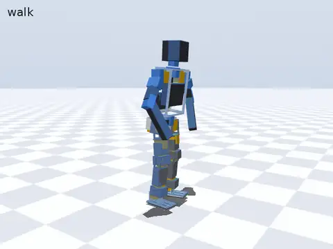
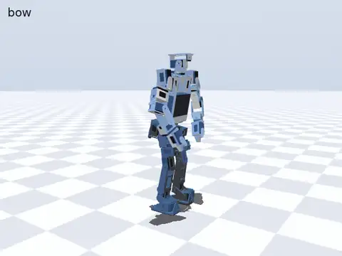
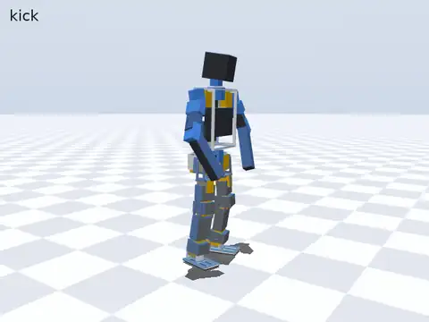
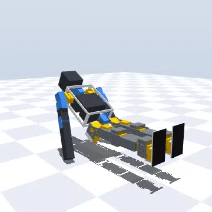

# Marvin Bot Mini

[](https://github.com/kranthie/marvin-bot-mini/actions/workflows/ci.yml)   

A small, low-cost open humanoid for trying locomotion and skills: about 0.6 m tall and 2.9 kg, with 23 powered joints on Feetech serial-bus servos, a fully printed frame, and an NVIDIA Jetson Orin Nano Super 8 GB onboard, for about $1.6k in parts. It is the miniature of [Marvin Bot](https://github.com/kranthie/marvin-bot), the 1.41 m open humanoid, and keeps its architecture: one description drives everything else, the frame is drawn in code, every change is checked in MuJoCo, walking and skills are trained in Isaac Lab and ProtoMotions, and the servos' own firmware loop is modelled in every simulation so the policies are trained on the servo the robot will have.

**Status:** phase 1, robot in simulation. Nothing has been built yet; the parts are priced and not yet ordered. The legs, pelvis and torso are drawn in code-CAD (first pass) and the URDF is generated from them. In MuJoCo the simulated servos hold the robot through standing, squatting and the poses of getting up, within their torque limits on an empty battery. A walking policy trained in Isaac Lab walks, turns and stops in a MuJoCo cross-check on the servo model, and one motion-tracking policy plays 25 skills from human motion, upright in every clip in MuJoCo on the servo model (see the [skills page](docs/skills.md)). See [docs/roadmap.md](docs/roadmap.md).

**Website:** <https://kranthie.github.io/marvin-bot-mini/>, with the robot in 3-D, a 3-D model page (layers, assembly order, skills with live servo loads) and these docs.

**Start here:** this README, then [docs/plan.md](docs/plan.md) (phases), [docs/roadmap.md](docs/roadmap.md) (where things stand), [docs/decisions.md](docs/decisions.md) (why things are the way they are) and the [glossary](docs/README.md#glossary). To try it: `pip install -e ".[dev,sim,cad]" && tools/check_all.sh`.

> [!WARNING]
> **Work in progress, not yet built or tested on hardware.** The designs, policies and scripts
> here are shared for reference, research and learning, and have only run in simulation. Even a
> 3 kg robot on a lithium battery can pinch fingers, fall onto things or start a battery fire.
> Build or power any part of it only at your own risk, following [docs/safety.md](docs/safety.md):
> everything is provided as is, without warranty, under the licences below. Report safety issues
> privately ([SECURITY.md](SECURITY.md)).


<sub>MuJoCo render of the generated model (`tools/render_robot.py`).</sub>

## In simulation

| Walking | Bowing | Kicking |
|---|---|---|
|  |  |  |

One motion-tracking policy plays the skills: the solid robot is the trained policy, the translucent blue robot the reference motion it follows (human motion generated with Kimodo and retargeted to the mini). It is trained on Newton in ProtoMotions and replayed in MuJoCo on the full servo model, where every clip stays upright; the squat and pick-up stop about 12 cm higher than the reference, and the arm gestures are the least accurate. All of them, with their tracking errors, are on the [skills page](docs/skills.md), and the pipeline is in [sim/motion/README.md](sim/motion/README.md).


A separate walking policy (flat v3) is trained in Isaac Lab and replayed in MuJoCo with the servo model, sensor noise and a command delay: it walks at 0.2-0.3 m/s, turns and stops on an empty or a nominal pack, with the knees at 60-81% of their rated torque. Its training and results are in [sim/isaaclab/README.md](sim/isaaclab/README.md).

| Squat | Rising from a crouch | Sitting up on the hands |
|---|---|---|
|  |  |  |

<sub>The torque check's cases (`sim/mujoco/check_torques.py`), held by the simulated servos on an empty pack: the check that settled the servo choice before the parts were priced.</sub>

## Goals

- Walk, turn and stop on flat ground; recover from light pushes; get up after a fall, face up and face down.
- Play skills learned by tracking human motion (gestures, squats, a kick, a dance), with Marvin Bot's pipeline: text-to-motion with Kimodo, retargeting, a ProtoMotions tracker.
- See with a head camera: walk to and kick a ball, follow a person or a tag.
- Run its policies onboard on the Orin Nano at 50 Hz; train on a desktop GPU.
- Stay cheap and quick to build: about $1.6k in parts (`bom/bom.xlsx`, totalled by `tools/bom/summary.py`), a desktop 3D printer and no machining.
- Be fully open: CAD, electronics, firmware, simulation and training code.

The full list is in [docs/requirements.md](docs/requirements.md).

## Built on

Marvin Bot Mini is a new design, but it stands on open work by others:

- **Architecture and tools:** [Marvin Bot](https://github.com/kranthie/marvin-bot), by the same contributors: the description format, URDF builder, checks, BOM workbook, walking tasks, motion pipeline and website, adapted.
- **Small open humanoids and servo models:** [ToddlerBot](https://github.com/hshi74/toddlerbot), [Open Duck Mini](https://github.com/apirrone/Open_Duck_Mini) and the [Zeroth bot](https://github.com/zeroth-robotics/zeroth-bot) (ideas and reference figures), and [BAM](https://github.com/Rhoban/bam) by Rhoban, whose servo model structure the simulations use.
- **Training and simulation:** NVIDIA [Isaac Lab](https://github.com/isaac-sim/IsaacLab) and Newton, [ProtoMotions](https://github.com/NVlabs/ProtoMotions) with [PyRoki](https://github.com/chungmin99/pyroki) for motion tracking on human motion generated with [Kimodo](https://github.com/nv-tlabs/kimodo), and [MuJoCo](https://github.com/google-deepmind/mujoco) for the cross-checks.
- **Servos:** Feetech's published STS3250 datasheet and STS3215 listings.
- **Built with [Claude](https://claude.ai) and [Claude Code](https://claude.com/claude-code)** (Anthropic): the design, CAD, simulation, training code and documentation were developed with them; commits they contributed to are marked `Co-Authored-By: Claude`.

Every source, with its licence and what was used from it, is in [ACKNOWLEDGMENTS.md](ACKNOWLEDGMENTS.md).

## Design at a glance

| | |
|---|---|
| Height, mass | ~0.60 m; 2.92 kg bare, 3.12 kg with the add-on shells (`tools/check_description.py`; legs and torso from the CAD, the rest estimates); 3.0 kg target, 3.5 kg limit |
| Joints | 6 per leg (hip roll, pitch and yaw, knee, ankle pitch and roll), 4 per arm (shoulder pitch, roll and yaw, elbow), waist yaw, 2 neck; Marvin Bot's joint names |
| Servos | Feetech STS3250 (4.9 N·m stall) on the legs and shoulder pitch, STS3215 12 V (2.9 N·m stall) on the rest of the arms, the waist and neck; magnetic 12-bit encoders, position control |
| Buses | three Feetech serial buses at 1 Mbit/s (each leg, the upper body), 50 Hz control |
| Compute | Jetson Orin Nano Super 8 GB onboard: control loop, policies, light vision; desktop GPU for training |
| Sensing | pelvis IMU, wide-angle head camera, the servos' position, load, voltage and temperature |
| Power | 3S Li-ion, 3.5 Ah (39 Wh), straight to the 12 V servos through a fuse and the e-stop; a buck-boost supply for the computer |
| Frame | printed (PETG, nylon-carbon at the hips and knees), steel pins and bearings on the far side of loaded joints |
| Software | Isaac Lab for training with the servo model, MuJoCo as a cross-check, ProtoMotions for motion tracking |

The joint list, ranges and servos are defined in [description/robot.yaml](description/robot.yaml), the single source of truth for everything else.

## Repository layout

```
docs/          plan, requirements, roadmap, safety, decisions, skills, media (renders, clips)
description/   robot.yaml (joints, sizes, servos, buses, power, torque rule), actuators.yaml
               (servos and their simulation model), mass_budget.yaml, skeleton.yaml (frames, mass
               placement), cad_model.yaml and urdf/ (generated)
cad/           code-CAD of the printed parts (build123d), their mass build and export
bom/           bill of materials workbook (bom.xlsx): bought parts by group, sourcing, totals, and
               the CAD's list of made parts
sim/           the servo model; mujoco/: the robot in MuJoCo, the torque, symmetry and policy
               checks; isaaclab/: the Isaac Lab package (servo actuator, walking tasks);
               motion/: the motion pipeline (retargeting, tracking, MuJoCo replay, clips)
tools/         description check, URDF builder, BOM workbook and summary, renders, check_all.sh
tests/         unit tests
site/          the documentation website (Astro Starlight): 3-D home page, 3-D model page, docs
               synced from this repository's Markdown (site/README.md)
```

Still to come, as phases reach them: `bench/` and `robot/` (phase 2), a harness generator in
`electrical/`, and build guides.

## Checks

```bash
python3.12 -m venv .venv && . .venv/bin/activate   # CI uses Python 3.12; 3.10 or later works
pip install -e ".[dev,sim,cad]"
tools/check_all.sh                  # every check CI runs, in CI's order
```

Or one at a time:

```bash
python tools/check_description.py   # joints, servos, bus timing, torque budget, mass, BOM counts
python tools/bom/summary.py         # BOM totals by group; quantity of each servo model
python tools/bom/book.py --check    # BOM workbook valid and tidy (python tools/bom/book.py tidies it)
python tools/build_urdf.py --check  # URDF matches the description files
python -m cad.build                 # part meshes, masses and sizes (cad_model.yaml)
python -m cad.export                # STL per part (outputs/), the workbook's made-parts sheet
python sim/mujoco/check_torques.py  # held poses on the servo model, against the torque rule
python sim/mujoco/check_symmetry.py # the training's left-right mirror rule against the model
pytest -q tests
MUJOCO_GL=egl python tools/render_robot.py   # the renders above; MUJOCO_GL=egl without a display
```

CI (`.github/workflows/ci.yml`) runs `tools/check_all.sh` on every push and pull request; the
website is built and deployed by `.github/workflows/pages.yml`.

## Build status

Nothing here is ready to build from yet. What exists, and what a builder would still need:

| Area | Status |
|---|---|
| Frame | code-CAD first pass of the legs, pelvis and torso; STL per part; arms and head still estimates; no fasteners, horn bolt patterns or bearing seats; no stress check |
| Printed parts | STL; no print settings |
| Electronics | power topology and bus layout in `description/robot.yaml`; no wiring harness or schematics |
| Battery | parts chosen (a 3S pack with a protection board); not built |
| Servo model | from datasheets and BAM's STS3215 figures; to be fitted on the bench (phase 2) |
| Software on the robot | not written yet (phase 2) |

## Licences

Copyright 2026 The Marvin Bot contributors.

| Path | Licence |
|---|---|
| `cad/` (part generators), `description/` (robot description, URDF), `electrical/`, `bom/`, `docs/design/*.svg` | [CERN-OHL-S-2.0](LICENSES/CERN-OHL-S-2.0.txt) (hardware) |
| Everything else: `tools/`, `sim/`, `robot/`, `bench/`, `tests/`, `site/` (the website), the documentation and media | [Apache-2.0](LICENSE) |
| The website's 3-D model data (generated from `description/` and `cad/` when the site is built) | [CERN-OHL-S-2.0](LICENSES/CERN-OHL-S-2.0.txt) |
| Portions of `sim/isaaclab/` marked in their headers | also BSD-3-Clause, © The Isaac Lab Project Developers ([text](LICENSES/BSD-3-Clause-IsaacLab.txt)) |

[NOTICE](NOTICE) lists the third-party material and the hardware licence's source location. Vendor CAD models and motion data are not redistributed here; see [CONTRIBUTING.md](CONTRIBUTING.md). Credits for the projects and products this design learns from are in [ACKNOWLEDGMENTS.md](ACKNOWLEDGMENTS.md). Everything is provided as is, without warranty, as these licences state.

## Safety

Even a small robot on a lithium battery can hurt people or start a fire. Read [docs/safety.md](docs/safety.md) before powering any servo. Report safety or security issues privately, as described in [SECURITY.md](SECURITY.md).

## Contributing

See [CONTRIBUTING.md](CONTRIBUTING.md). Everyone taking part is expected to follow the [code of conduct](CODE_OF_CONDUCT.md).
