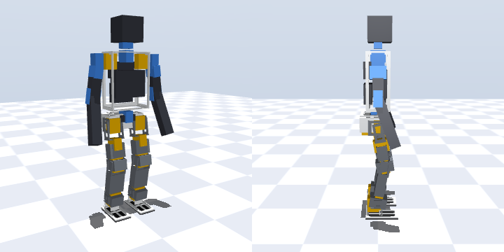
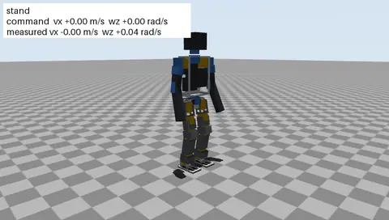
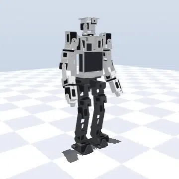
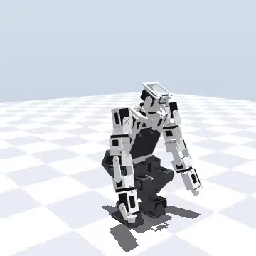

# Marvin Bot Mini

  

A small, low-cost open humanoid for trying locomotion and skills: about 0.6 m tall and 3 kg, with 23 powered joints on Feetech serial-bus servos, a fully printed frame, and an NVIDIA Jetson Orin Nano Super 8 GB onboard. It is the miniature of [Marvin Bot](https://github.com/kranthie/marvin-bot), the 1.41 m open humanoid, and keeps its architecture: one description drives everything else, the frame is drawn in code, every change is checked in MuJoCo, walking and skills are trained in Isaac Lab and ProtoMotions, and the servos are modelled from bench measurements so the policies carry over to the real robot.

**Status:** phase 1, robot in simulation. Nothing has been built yet. The legs, pelvis and torso are drawn in code-CAD (first pass), the URDF is generated from them, and in MuJoCo the simulated servos hold the robot through standing, squatting and the poses of getting up, within their torque limits on an empty battery. A first walking policy, trained in Isaac Lab on the servo model, walks, turns and stops in a MuJoCo cross-check with the same model, on an empty or a nominal pack. See [docs/roadmap.md](docs/roadmap.md).





| Squat | Rising from a crouch | Sitting up on the hands |
|---|---|---|
|  |  |  |

<sub>MuJoCo renders of the generated model (`tools/render_robot.py`): the torque check's cases, played by the simulated servos on an empty pack.</sub>

**Start here:** this README, then [docs/plan.md](docs/plan.md) (phases), [docs/roadmap.md](docs/roadmap.md) (where things stand) and [docs/decisions.md](docs/decisions.md) (why things are the way they are). To try it: `pip install -e ".[dev]" && python tools/check_description.py`.

> [!WARNING]
> **Work in progress, not yet built or tested.** A 3 kg robot on a lithium battery can still pinch
> fingers, fall on things and start a battery fire. Follow [docs/safety.md](docs/safety.md), at your
> own risk: everything is provided as is, without warranty, under the licences below.

## Goals

- Walk, turn and stop on flat ground; recover from light pushes; get up after a fall, face up and face down.
- Play skills learned by tracking human motion (gestures, squats, a kick, a dance) with the same pipeline as Marvin Bot: text-to-motion with Kimodo, retargeting, a ProtoMotions tracker.
- See with a head camera: walk to and kick a ball, follow a person or a tag.
- Run its policies onboard on the Orin Nano at 50 Hz; train on a desktop GPU.
- Stay cheap and quick to build: about $1.55k in parts besides the computer ($1.8k with it, `bom/bom.yaml`), a desktop 3D printer and no machining.
- Be fully open: CAD, electronics, firmware, simulation and training code.

## Design at a glance

| | |
|---|---|
| Height, mass | ~0.60 m; 2.92 kg bare, 3.12 kg with the add-on shells (`tools/check_description.py`; legs and torso from the CAD, the rest estimates); 3.0 kg target, 3.5 kg limit |
| Joints | 6 per leg (hip roll, pitch and yaw, knee, ankle pitch and roll), 4 per arm (shoulder pitch, roll and yaw, elbow), waist yaw, 2 neck; Marvin Bot's joint names |
| Servos | Feetech STS3250 (4.9 N·m stall) on the legs and shoulder pitch, STS3215 12 V (2.9 N·m stall) on the rest of the arms, the waist and neck; magnetic 12-bit encoders, position control |
| Buses | three Feetech serial buses at 1 Mbit/s (each leg, the upper body), 50 Hz control |
| Compute | Jetson Orin Nano Super 8 GB onboard: control loop, policies, light vision; desktop GPU for training |
| Sensing | pelvis IMU, wide-angle head camera, the servos' position, load, voltage and temperature |
| Power | 3S Li-ion, ~3 Ah, straight to the 12 V servos through a fuse and the e-stop; a regulated supply for the computer |
| Frame | printed (PETG, nylon-carbon at the hips and knees), steel pins and bearings on the far side of loaded joints |
| Software | Isaac Lab for training with a fitted servo model, MuJoCo as a cross-check, ProtoMotions for motion tracking |

The joint list, ranges and servos are defined in [description/robot.yaml](description/robot.yaml), the single source of truth for everything else.

## Repository layout

```
docs/          plan, requirements, roadmap, safety, decisions, media (renders, animations)
description/   robot.yaml (joints, sizes, servos, buses, power), actuators.yaml (servos and their
               simulation model), mass_budget.yaml, skeleton.yaml (frames, mass placement),
               cad_model.yaml and urdf/ (generated)
cad/           code-CAD of the printed parts (build123d) and their mass build
bom/           bill of materials (bom.yaml)
sim/           the servo model; mujoco/: the robot in MuJoCo, the torque, symmetry and policy
               checks; isaaclab/: the Isaac Lab package (servo actuator, walking tasks)
tools/         description check, URDF builder, BOM summary, renders, check_all.sh
tests/         unit tests
```

Still to come: `sim/motion/` (phase 1), `bench/` and `robot/` (phase 2), and the website.

## Checks

```bash
python3.12 -m venv .venv && . .venv/bin/activate   # CI uses Python 3.12; 3.10 or later works
pip install -e ".[dev,sim,cad]"
tools/check_all.sh                  # every check CI runs, in CI's order
```

## Built on

- **[Marvin Bot](https://github.com/kranthie/marvin-bot):** the architecture, conventions and tools, by the same contributors.
- **Small open humanoids and servo models:** [ToddlerBot](https://github.com/hshi74/toddlerbot), [Open Duck Mini](https://github.com/apirrone/Open_Duck_Mini), the [Zeroth bot](https://github.com/zeroth-robotics/zeroth-bot) and [BAM](https://github.com/Rhoban/bam) (ideas and methods; see [ACKNOWLEDGMENTS.md](ACKNOWLEDGMENTS.md)).
- **Built with [Claude](https://claude.ai) and [Claude Code](https://claude.com/claude-code)** (Anthropic); commits they contributed to are marked `Co-Authored-By: Claude`.

## Licences

Copyright 2026 The Marvin Bot contributors.

| Path | Licence |
|---|---|
| `cad/`, `description/`, `electrical/`, `bom/`, `docs/design/*.svg` | [CERN-OHL-S-2.0](LICENSES/CERN-OHL-S-2.0.txt) (hardware) |
| Everything else: `tools/`, `sim/`, `robot/`, `bench/`, `tests/`, the documentation | [Apache-2.0](LICENSE) |
| Portions of `sim/isaaclab/` marked in their headers | also BSD-3-Clause, © The Isaac Lab Project Developers ([text](LICENSES/BSD-3-Clause-IsaacLab.txt)) |

[NOTICE](NOTICE) lists third-party material. Everything is provided as is, without warranty, as these licences state.

## Safety and contributing

Read [docs/safety.md](docs/safety.md) before powering any servo, and report safety or security issues privately ([SECURITY.md](SECURITY.md)). See [CONTRIBUTING.md](CONTRIBUTING.md); everyone taking part is expected to follow the [code of conduct](CODE_OF_CONDUCT.md).
