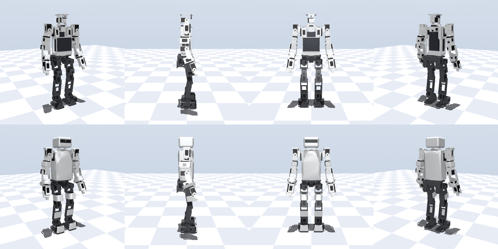

# Assembly

How the printed parts, servos, hardware and harness go together, in build order. Every part is
generated by the code-CAD in `cad/` (`python -m cad.build`; the STLs for a slicer from
`python -m cad.export`), and the hardware each part takes is listed per part in
`description/cad_model.yaml`. Nothing here has been built yet: this is the design's build
order, to be checked on the first robot. Read [safety.md](safety.md) first.

## The design in one paragraph

Every joint is one servo and three printed features: a **cradle** round the servo's case on one
link (two M2 screws into each end of the case, a notch for its two bus sockets), a **horn
plate** on the other link (four M2 screws into the servo's horn) and, where the joint is carried
on both sides, an **idler plate** with a 683 bearing turning on an M3 pin screwed into a
heat-set insert in the cradle's floor. Hips, knees, ankle pitch, shoulder roll, elbows and neck
pitch are carried on both sides; the yaw joints, ankle roll, shoulder pitch, wrist and gripper
hang off the servo's own bearing. The clip-on shells hook into slots in the frame and take one
or two M2 screws into heat-set inserts on bosses that reach out from the frame to them.

## Before printing

The servo figures the CAD uses are from the datasheet outline, not yet measured. On one STS3250
and one STS3215, measure and correct in `description/actuators.yaml` (`shape`) and
`cad/servo.py` before printing anything:

| What | Assumed | Where it is set |
|---|---|---|
| The shaft's offset from the case's centre, along its length | 11.5 mm | `actuators.yaml` `shaft_offset` |
| The case's depth below its top face; the spline and horn above it | 30.0 mm; 5.8 mm | `actuators.yaml` `axial` |
| The round horn's screw circle and screws | 4 x M2 on a 14 mm circle | `cad/servo.py` `HORN_PCD` |
| The case's mounting holes in its end faces | 2 per end, 14 mm apart, 15 mm below the top face | `cad/servo.py` `EAR_Y`, `EAR_Z` |
| The bus sockets' notch in the far end | 16 x 9 mm | `cad/servo.py` `CONN_W`, `CONN_H` |

Then `python -m cad.build && python -m cad.check && python tools/build_urdf.py` and print one
cradle and one horn plate (the hip pitch's) to test the fit before the rest.

## Printing

| Material | Parts | Notes |
|---|---|---|
| Nylon-carbon (PA6-CF), printed dry | pelvis, hip roll and pitch brackets, thighs, shins, ankle brackets, feet | the leg's loads; dry the filament first |
| PETG, white | torso frame, shoulder brackets and yokes, upper arms, forearms, palms, jaws, neck yoke, head frame; all shells but two | |
| PETG, black | hip girdle, visor | |
| TPU 95A | foot soles, finger pads | glued on |

Print plates flat and cradles open side up; the torso shells and the head's back piece upright.
Every part fits a 220 mm bed (`python -m cad.build` checks it). Masses are for solid walls, as
the parts are drawn at wall thickness: print the frame solid (100% infill, or enough perimeters to
fill the walls), as the stress check assumes.

The stress check (`python -m cad.fea`, below) takes the material's strength between layers
(25 MPa), the weak direction, everywhere, so the print orientation does not change its result.

## Preparation

1. Press the 683 bearings into the 15 idler plates (with their lip on the outside).
2. Set the heat-set inserts: an M3 x 3 into each idler cradle's floor boss (15), an M2 x 3 into
   each shell boss (20).
3. On the bench, give each servo its ID and limits on its bus (the left leg, the right leg, the
   upper body: robot.yaml `motors`), and centre it. Set the two neck servos' torque limit to 30%
   (robot.yaml `torque_limit`): the neck yoke is sized for that, not for their full stall torque.
4. Cut and label the bus leads (below).

## Build order

Each step's parts and the hardware it takes (both sides where there are two). The servos go into
their cradles before the next part's horn plate is screwed on.

| Step | Parts | Hardware |
|---|---|---|
| 1 | pelvis, with the waist and both hip roll servos | 12 x M2 x 6 (cases) |
| 2 | hip roll brackets, with the hip pitch servos | 8 + 8 x M2 x 6, 2 x M3 x 8 pins, 2 x 683 |
| 3 | hip pitch brackets | 16 x M2 x 6 (horns), 2 x M3 x 8, 2 x 683 |
| 4 | thighs, with the hip yaw and knee servos | 16 x M2 x 6 |
| 5 | shins, with the ankle pitch servos | 8 + 8 x M2 x 6, 2 x M3 x 8, 2 x 683 |
| 6 | ankle brackets, with the ankle roll servos | 8 + 8 x M2 x 6, 2 x M3 x 8, 2 x 683 |
| 7 | feet and soles | 8 x M2 x 6, 2 x M3 x 8, 2 x 683; soles glued |
| 8 | torso frame, with the shoulder pitch and neck yaw servos, the computer and battery; onto the waist horn | 4 + 12 x M2 x 6, 4 x M2.5 x 6 (computer), 2 straps (battery) |
| 9 | shoulder brackets, with the shoulder roll servos | 8 + 8 x M2 x 6 |
| 10 | shoulder yokes | 16 x M2 x 6, 2 x M3 x 8, 2 x 683 |
| 11 | upper arms, with the shoulder yaw and elbow servos | 16 x M2 x 6 |
| 12 | forearms, with the wrist servos | 8 + 8 x M2 x 6, 2 x M3 x 8, 2 x 683 |
| 13 | palms and jaws, with the gripper servos | 16 + 8 x M2 x 6; finger pads glued |
| 14 | neck yoke | 8 x M2 x 6, 1 x M3 x 8, 1 x 683 |
| 15 | head frame, with the neck pitch servo and the camera | 4 + 2 x M2 x 6 |
| — | calibrate: hung from a stand, every joint zeroed and run through its range at low torque | |
| 16 | the limb shells and the hip girdle | 13 x M2 x 6 |
| 17 | the torso shells | 4 x M2 x 6 |
| 18 | the head's face, visor and back | 3 x M2 x 6 |

In all: 27 servos, 15 bearings, 15 M3 and 20 M2 heat-set inserts, 15 M3 x 8 and about 240 M2 x 6
screws, 4 M2.5 x 6 screws (the BOM's hardware line).

## Wiring

Each bus is a daisy chain of three-wire leads (ground, 12 V, data) with 5264-type three-pin
plugs; each servo has two sockets in its case's far end, which faces the next servo along the
chain. The legs' chains start at their bus adapters on the pelvis's front, the arms' and the
neck's at the power board high in the torso's back, which also feeds the waist servo and runs
12 V and ground down through the waist to the leg adapters.

Where a lead crosses a joint it leaves a service loop in the gap the shells leave there, tied
either side of the joint through the frame's paired cable-tie slots. `python -m cad.harness`
gives each lead's length (its run times 1.35, plus the loop for every joint it crosses) and
rounds it to a stock length:

| Chain (each side) | Leads |
|---|---|
| Leg: adapter, hip roll, hip pitch, hip yaw, knee, ankle pitch, ankle roll | 150, 200, 200, 100, 300, 150 mm |
| Arm: power board, shoulder pitch, roll, yaw, elbow, wrist, gripper | 100, 200, 300, 100, 150, 150 mm |
| Neck: power board, neck yaw, neck pitch | 100, 200 mm |
| Waist: power board, waist yaw | 300 mm |

In all 27 leads: 7 x 100, 8 x 150, 7 x 200 and 5 x 300 mm, and about 0.26 m of 12 V lead from
the power board to the pelvis.

## Stress check

`python -m cad.fea` loads each printed part where its servos and the next link meet it (a landing
on one foot at three body weights, a sideways fall, a hand catching half the body weight, the head
dropped, and each servo's stall torque) and reports its peak stress against the printed material's
strength between layers, for a safety factor of at least 2.2. Its results are in
[decisions](decisions.md) (2026-11-11). The thicker plates the check asked for take longer screws
nowhere: the horn plates over 3.2 mm thick are counterbored so an M2 x 6 still reaches the horn.

## Shells

Each shell hooks into its frame slots at one end, then takes its screws at the other: the torso
shells at the bottom of their sides and at the top plate, the limb shells on their servo
cradles' end walls, the head's face at the camera plate and its back at the head frame's spine.
Every shell comes off with one screwdriver, and none carries load. `python -m cad.check` moves
every joint through its range and fails if any part or shell meets another, or a shell cuts
into the frame it covers.
