# Skills in simulation

Every skill the motion tracker has learned, on the current model. The solid robot is the trained
policy; the translucent blue robot is the reference motion it follows (a human motion generated
with Kimodo and retargeted to the mini). One policy plays all 30 clips, the five newest for the
wrists and pincers: trained 3,000 epochs on Newton with 16,384 robots at once and the servo-load
penalty, then 600 more on the strengthened frame's mass (about 5 hours in all on one GPU). The
clips are its replay in MuJoCo on the full servo model (`sim/motion/replay_mujoco.py`: the duty
cycle, back-EMF, pack voltage, a 10 ms command delay and sensor noise), not the training
simulator. Under each clip: the hands' and feet's mean distance from where the reference puts
them, measured relative to the pelvis; a hand is measured at the wrist.

The clips are rendered with `sim/motion/render_tracking.py`; how they are made, trained and scored
is in [sim/motion/README.md](../sim/motion/README.md). This is simulation only; nothing has run on
hardware.

What works and what does not yet:

- **Upright in 29 of 30 clips** in MuJoCo, and in all 30 in Newton. The two-hand wave falls in
  MuJoCo within its first second: the policy lets its feet drift together (the reference keeps
  them 14 cm apart) and the soles catch. It does so with the noise and command delay off too, and
  the tracker before the wrists' clips did not: a gap between the two simulators to close.
- **Walking and turning track closely:** hands 2.6–5.4 cm and feet 1.9–4.1 cm off on the walks, turns and
  start-stop. The sidesteps and walking back cover 43–55% of the reference's distance.
- **The wrists and pincers:** pouring, handing over and turning a knob put the hand within 3 cm of
  the reference; drinking within 8 cm. Screwing in a bulb overhead is 9 cm off: the arm reaches
  0.24 m and the hand stays in front of the head rather than above it. The pincer follows its
  schedule (open on the way to an object, closed on it, open to let go) on the right hand.
- **The squat and pick-up stop high.** The reference lowers the pelvis to 0.15 m; the robot stops
  at 0.27 m. The deep squat is not learned yet.
- **The arm-heavy gestures are the weakest** (arms raise, clap: hands 12–13 cm off). The arms'
  poses are scaled to their 0.24 m reach.
- **Servo load.** In MuJoCo the hardest-working joint (a hip roll in nearly every clip) runs at
  48–86% of its servo's rated torque, RMS over the clip.

## Walking and turning

| Walk | Walk slow | Walk back |
|---|---|---|
| 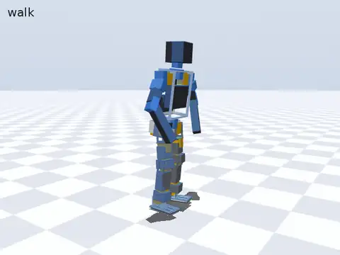 |  | 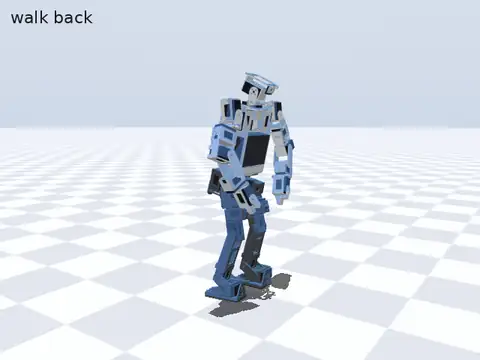 |
| hands 4.0 cm, feet 3.5 cm | hands 3.8 cm, feet 2.4 cm | hands 3.6 cm, feet 3.0 cm |

| Jog | March | Start stop |
|---|---|---|
| 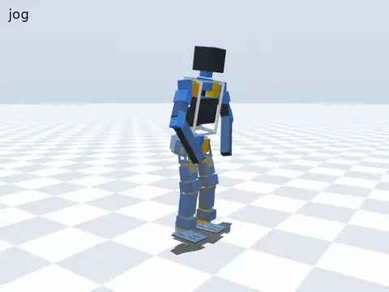 | 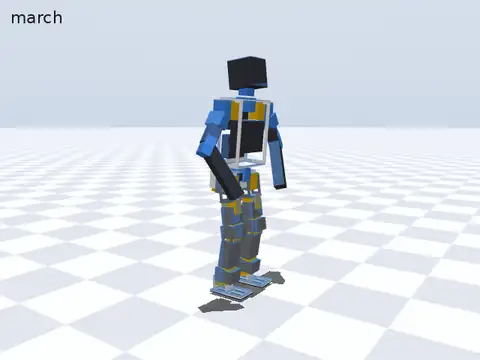 | 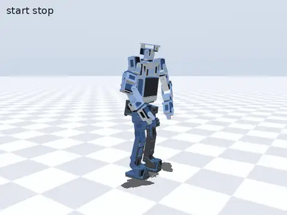 |
| hands 5.4 cm, feet 4.1 cm | hands 3.4 cm, feet 2.9 cm | hands 2.6 cm, feet 2.6 cm |

| Carry walk | Side left | Side right |
|---|---|---|
| 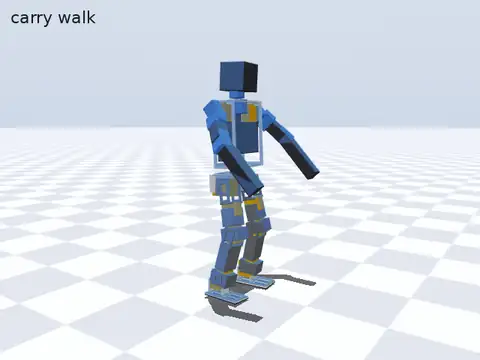 |  |  |
| hands 4.8 cm, feet 3.7 cm | hands 3.3 cm, feet 5.2 cm | hands 2.6 cm, feet 3.1 cm |

| Turn left | Turn right | Turn in place |
|---|---|---|
| 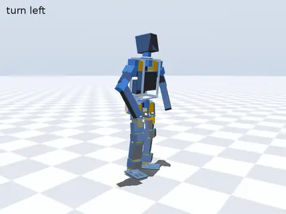 |  |  |
| hands 3.4 cm, feet 3.0 cm | hands 3.5 cm, feet 2.8 cm | hands 3.1 cm, feet 1.9 cm |

## Whole body

| Kick | Squat | Pick up |
|---|---|---|
|  | 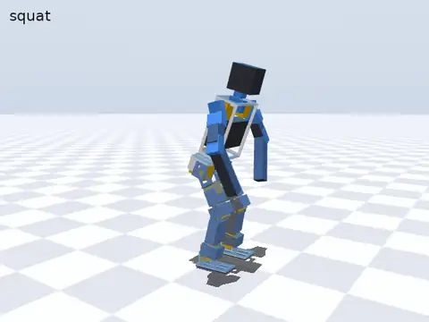 | 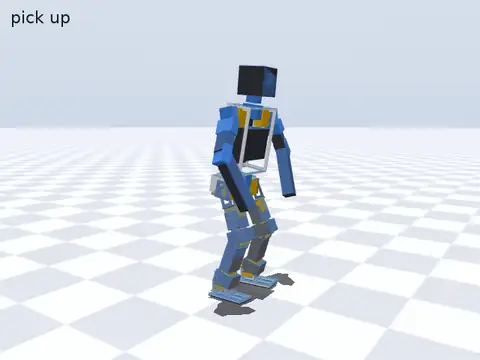 |
| hands 4.0 cm, feet 3.7 cm | hands 13.2 cm, feet 8.4 cm | hands 5.9 cm, feet 6.1 cm |

| Bow | Dance sway | Idle |
|---|---|---|
|  | 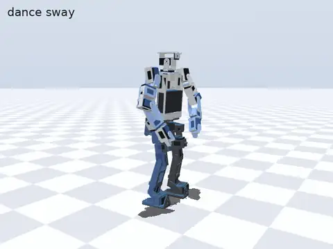 |  |
| hands 4.0 cm, feet 2.3 cm | hands 4.7 cm, feet 3.5 cm | hands 2.0 cm, feet 3.3 cm |

| Look around |
|---|
| 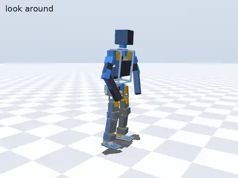 |
| hands 2.8 cm, feet 3.5 cm |

## Arms and gestures

| Clap | Wave | Wave both |
|---|---|---|
|  | 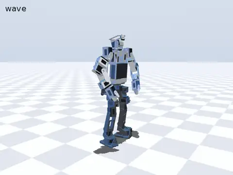 | 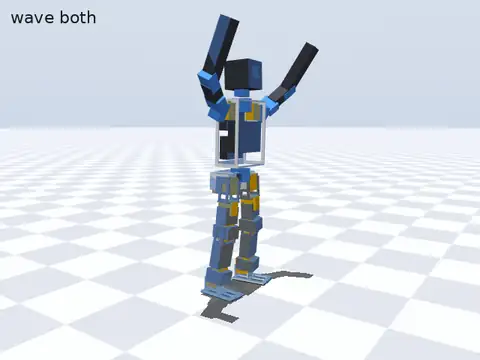 |
| hands 11.6 cm, feet 3.2 cm | hands 4.8 cm, feet 3.4 cm | fell at 0.8 s |

| Point | Reach forward | Arms raise |
|---|---|---|
| 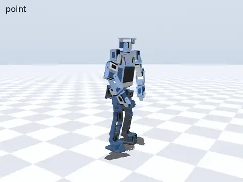 |  | 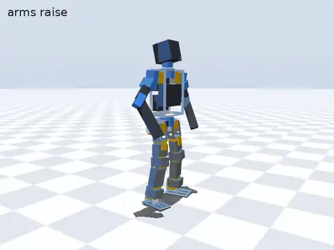 |
| hands 3.7 cm, feet 2.7 cm | hands 9.1 cm, feet 3.0 cm | hands 13.1 cm, feet 3.4 cm |

## Wrists and hands

The five clips made for the wrists and pincers. The wrist turns with the person's hand; the right
pincer opens and closes on a schedule per clip.

| Pour | Drink | Turn knob |
|---|---|---|
| 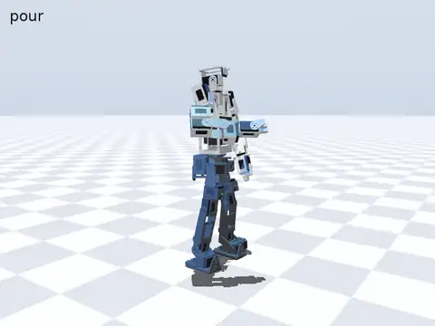 | 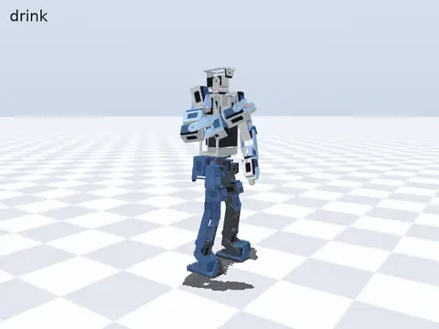 | 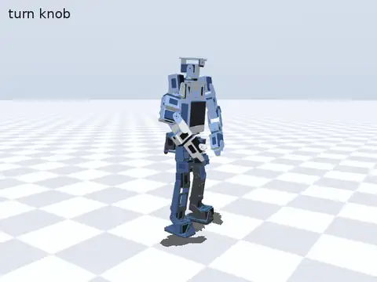 |
| hands 3.1 cm, feet 3.7 cm | hands 8.1 cm, feet 3.5 cm | hands 3.1 cm, feet 2.8 cm |

| Screw bulb | Hand over |
|---|---|
| 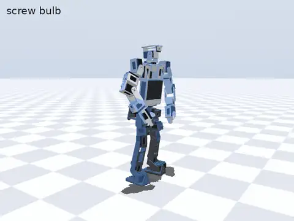 | 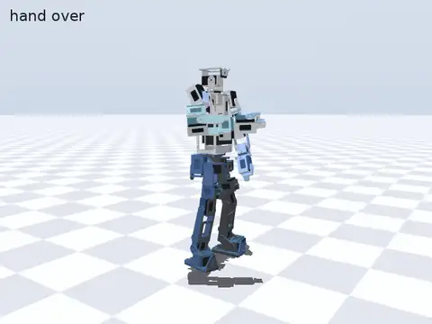 |
| hands 8.6 cm, feet 3.5 cm | hands 3.0 cm, feet 3.5 cm |
