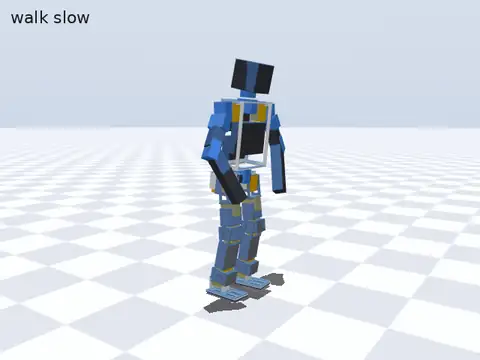
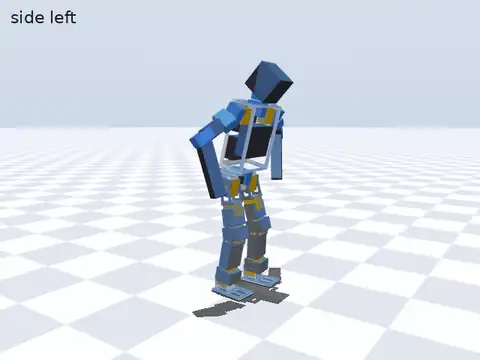
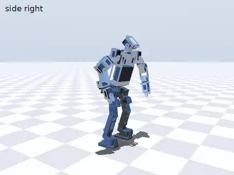
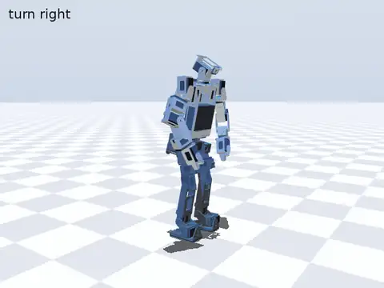
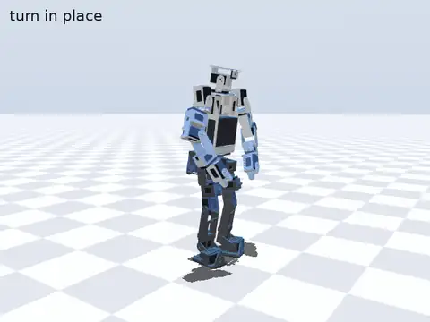
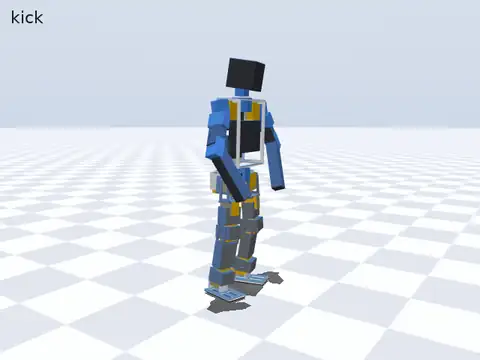
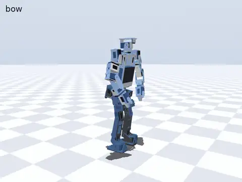
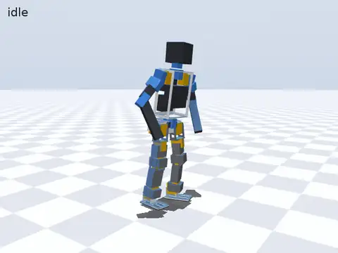
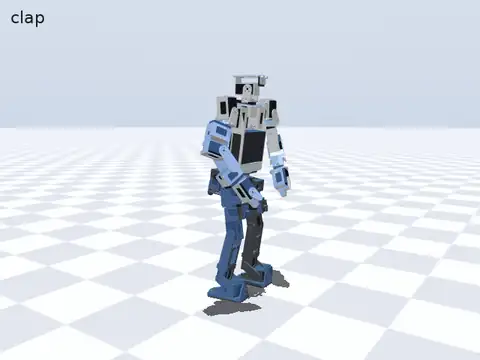
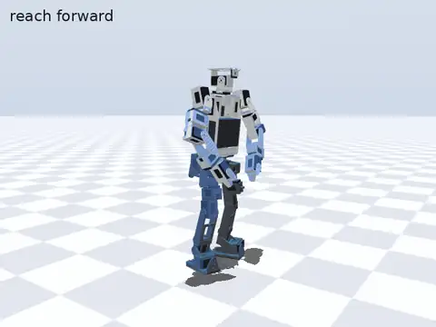

# Skills in simulation

Every skill the motion tracker has learned, on the current model. The solid robot is the trained
policy; the translucent blue robot is the reference motion it follows (a human motion generated
with Kimodo and retargeted to the mini). One policy plays all 25 clips: trained 2,400 epochs on
Newton with 16,384 robots at once, then 1,000 more with a stronger penalty on the servos' load
(about 3 hours in all on one GPU). The clips are its replay in MuJoCo on the full servo model
(`sim/motion/replay_mujoco.py`: the duty cycle, back-EMF, pack voltage, a 10 ms command delay and
sensor noise), not the training simulator. Under each clip: the hands' and feet's mean distance
from where the reference puts them, measured relative to the pelvis. The mini has no hands; a
hand is the end of the forearm.

The clips are rendered with `sim/motion/render_tracking.py`; how they are made, trained and scored
is in [sim/motion/README.md](../sim/motion/README.md). This is simulation only; nothing has run on
hardware.

What works and what does not yet:

- **Upright in every clip.** The robot stays on its feet through all 25, in Newton and in MuJoCo.
- **Walking and turning track closely:** hands 2–4 cm and feet 2–4 cm off on the walks, turns and
  start-stop. The sidesteps and walking back cover 72–76% of the reference's distance.
- **The squat and pick-up stop high.** The reference lowers the pelvis to 0.15 m; the robot stops
  at 0.28 m, about 12 cm higher, with the knees at their stall torque. The deep squat is not
  learned yet.
- **The arm-heavy gestures are the weakest** (arms raise, the two-hand wave, clap: hands
  15–16 cm off). The arms reach 0.24 m, so the reference's arm poses are scaled down, and the
  upper arm servos peak at their stall torque.
- **Servo load.** In MuJoCo the hardest-working joint (a hip roll in nearly every clip) runs at
  46–79% of its servo's rated torque, RMS over the clip. The first tracker, trained without a load
  penalty, held both hip rolls at 2.8 times rated standing still.

## Walking and turning

| Walk | Walk slow | Walk back |
|---|---|---|
|  |  |  |
| hands 3.6 cm, feet 3.7 cm | hands 3.2 cm, feet 2.5 cm | hands 3.4 cm, feet 2.8 cm |

| Jog | March | Start stop |
|---|---|---|
|  |  |  |
| hands 5.7 cm, feet 3.8 cm | hands 4.0 cm, feet 2.5 cm | hands 2.4 cm, feet 2.4 cm |

| Carry walk | Side left | Side right |
|---|---|---|
|  |  |  |
| hands 6.6 cm, feet 3.6 cm | hands 5.0 cm, feet 3.8 cm | hands 4.4 cm, feet 3.5 cm |

| Turn left | Turn right | Turn in place |
|---|---|---|
|  |  |  |
| hands 2.6 cm, feet 2.9 cm | hands 3.6 cm, feet 3.7 cm | hands 2.9 cm, feet 1.6 cm |

## Whole body

| Kick | Squat | Pick up |
|---|---|---|
|  |  |  |
| hands 3.7 cm, feet 3.1 cm | hands 10.8 cm, feet 7.6 cm | hands 5.4 cm, feet 5.4 cm |

| Bow | Dance sway | Idle |
|---|---|---|
|  |  |  |
| hands 4.5 cm, feet 2.2 cm | hands 6.0 cm, feet 3.0 cm | hands 2.0 cm, feet 2.9 cm |

| Look around |
|---|
|  |
| hands 2.0 cm, feet 2.8 cm |

## Arms and gestures

| Clap | Wave | Wave both |
|---|---|---|
|  |  |  |
| hands 15.5 cm, feet 3.5 cm | hands 7.3 cm, feet 3.1 cm | hands 15.2 cm, feet 4.0 cm |

| Point | Reach forward | Arms raise |
|---|---|---|
|  |  |  |
| hands 4.3 cm, feet 2.3 cm | hands 8.4 cm, feet 3.1 cm | hands 15.5 cm, feet 3.7 cm |
